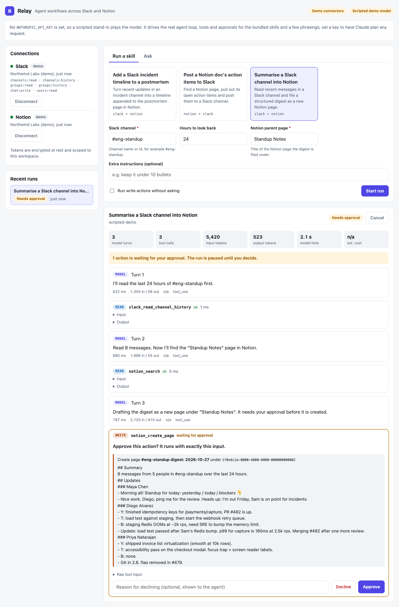
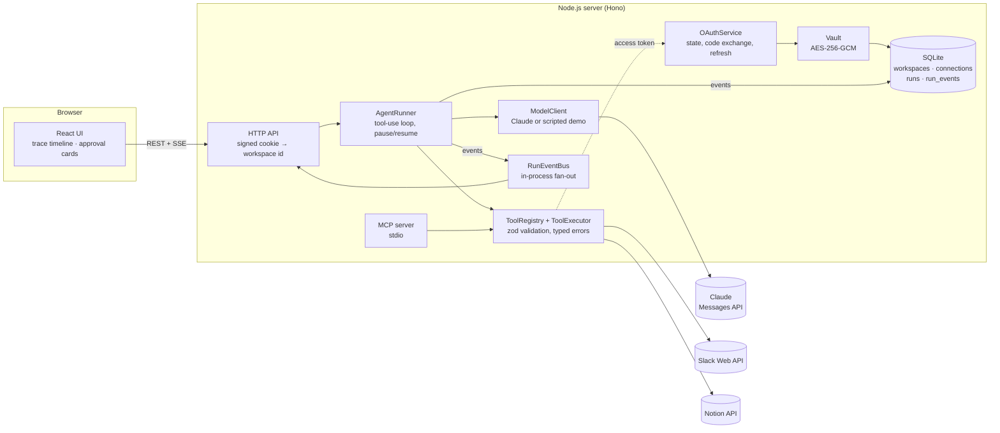

# Relay

Relay is an agent that does work across Slack and Notion. You type a request in plain English, or pick a reusable skill such as "summarise a Slack channel into a Notion page". Claude plans the work and calls tools through Slack and Notion connectors:

- **Read tools run immediately.** Listing channels, reading history, searching and reading pages.
- **Write tools wait for a person.** Posting a message, creating a page or appending to one pauses the run. The UI shows the exact tool input, and the run resumes only after someone approves or declines it. A decline (with an optional reason) goes back to the model, which is told not to retry.
- **Every step is traced live.** Model turns, tool calls with their inputs and outputs, latency, token usage and estimated cost stream to the browser over server-sent events.
- **Connections use OAuth 2.0.** Tokens are encrypted at rest, and all data is scoped to a workspace.
- **The same tools are available over MCP**, so other MCP clients can use the connectors too.

It runs end to end without any keys: a demo mode swaps in fake Slack and Notion workspaces and a scripted stand-in for the model.



<sub>Demo mode: fictional data, scripted model.</sub>

## Quick start (no keys needed)

Requires Node.js 22.13 or newer.

```bash
npm ci
npm run demo        # builds the UI and server, then serves both on http://localhost:8787
```

Open http://localhost:8787, pick a skill and press **Start run**. The run reads Slack, searches Notion, then stops on an approval card. Approve or decline it and watch the run finish. To see error handling, disconnect Notion in the sidebar and run a skill that needs it.

For development with hot reload, `npm run dev` starts the API on :8787 and Vite on http://localhost:5173 (Vite proxies `/api`).

The same flow works with curl. The session cookie identifies your workspace, so keep a cookie jar:

```bash
curl -c jar -b jar -s localhost:8787/api/session
curl -c jar -b jar -s localhost:8787/api/runs -H 'content-type: application/json' \
     -d '{"skillId":"notion-action-items-to-slack"}'
curl -b jar -N localhost:8787/api/runs/<run id>/events        # live trace (SSE)
curl -b jar -s localhost:8787/api/runs/<run id>/approve -H 'content-type: application/json' \
     -d '{"toolUseId":"<toolUseId from the approval_required event>"}'
```

## What is in the box

| Area | Where |
| --- | --- |
| Agent loop, approvals, trace events | `server/src/agent/runner.ts`, `server/src/agent/events.ts` |
| Model client (Claude) and scripted demo model | `server/src/agent/model.ts`, `server/src/agent/demo-model.ts` |
| Connectors: Slack and Notion, live clients and fakes | `server/src/connectors/` |
| OAuth 2.0 flow and token refresh | `server/src/oauth/` |
| Credential vault and session signing | `server/src/security/` |
| SQLite stores, all keyed by workspace | `server/src/store/`, `server/src/db.ts` |
| HTTP API and SSE stream (Hono) | `server/src/http/` |
| MCP server (stdio) | `server/src/mcp.ts`, `server/src/mcp-server.ts` |
| Skills | `skills/*.md`, loaded by `server/src/skills/loader.ts` |
| Web UI (React + Vite) | `web/src/` |

## Architecture



A run with a write tool, start to finish:

```mermaid
sequenceDiagram
  participant U as Browser
  participant A as API
  participant R as AgentRunner
  participant M as Claude
  participant T as Connectors

  U->>A: POST /api/runs {skillId}
  A->>R: start(workspace, skill)
  U->>A: GET /api/runs/:id/events (SSE)
  R->>M: turn 1 (system + tools + history)
  M-->>R: tool_use slack_read_channel_history
  R->>T: run read tool
  T-->>R: messages
  R->>M: turn 2 (+ tool_result)
  M-->>R: tool_use notion_create_page
  R-->>A: approval_required (exact input), status awaiting_approval
  Note over R: turn saved to the database, loop stops
  U->>A: POST /api/runs/:id/approve {toolUseId}
  A->>R: decide(approved)
  R->>T: run the approved write
  R->>M: turn 3 (+ tool_result)
  M-->>R: final text, end_turn
  R-->>A: done {answer}
  A-->>U: events stream throughout; the stream closes after done
```

## Design decisions and trade-offs

**A hand-written, resumable tool-use loop.** The Anthropic SDK has a tool runner, but approvals here can take minutes and have to survive a server restart. So `AgentRunner` owns the loop and persists everything it needs to continue after every turn: system prompt, tool list, the full message history and any pending tool calls. Approving a call loads that state from SQLite and carries on, in the same process or a new one. The cost is owning the details the runner would otherwise handle: stop reasons, ordering of parallel tool results, and the turn limit.

**Approval is per tool call, on the exact input.** When a turn mixes reads and writes, the reads run straight away and the writes wait. The turn resumes once every write in it has a decision, and all results go back to the model in one message, in the order it asked for them. Inputs are validated before anyone is asked to approve them, and what gets approved is exactly what runs. Runs can opt into auto-approve; it is off by default and shown in the trace when on.

**Errors are data for the model.** Connectors throw a `ConnectorError` with a code (`not_found`, `permission`, `rate_limited`, ...) and a hint ("Invite the bot to the channel with /invite"). The executor turns these, schema failures and unknown tools into `is_error` tool results, so the model can adapt instead of the run crashing. Failures that make a turn unusable end the run explicitly: a refusal, a turn cut off at `max_tokens` (a truncated tool input can still parse as a valid partial object, so its tools are never run), the turn limit, and API errors after the SDK's retries.

**Reliability around the model call.** Each turn is streamed with `finalMessage()`. Tool definitions use `strict: true` and `eager_input_streaming`, and every input is re-validated with zod before it runs, because eager streaming skips server-side validation. A turn whose tool input is not parseable JSON is re-issued (at most twice); typed API errors are not, since the SDK already retries 429s and 5xx with backoff. On models that support it, the request opts into the server-side refusal fallback and into short progress notes between tool calls, which the trace shows.

**Prompt-cache friendly, append-only history.** The tool list is sorted, and the system prompt is constant per skill (the current time goes in the first user message instead). Assistant turns are stored exactly as returned, thinking blocks included, and never edited. That keeps both the cached prefix and the model's earlier reasoning valid from one turn to the next.

**The trace is an event log.** Every step is appended to `run_events` with a per-run sequence number and published to an in-process bus. The SSE endpoint subscribes first, replays stored events after `Last-Event-ID`, then drains the live queue, de-duplicating by sequence number. A reconnect therefore misses no stored event, and a page reload rebuilds the same timeline through the same reducer (`web/src/trace.ts`). Text deltas are streamed live but not stored, so a reconnect can skip some of them; the final text of each turn is stored and replaces them.

**Skills are files, not code.** A skill is Markdown with YAML frontmatter: name, typed inputs with defaults, and an allowlist of tools. At startup the loader checks every tool name against the registry and every tool against the connectors the skill declares. A run started from a skill only offers those tools to the model, and the runner refuses calls to any other tool.

**One connector interface, two implementations.** Tools are written against `SlackApi` and `NotionApi`. Live clients call the real APIs with timeouts and Retry-After-aware retries. Fakes run on an in-memory demo world, one per workspace, and raise the same error codes. Demo mode and the test suite exercise the real tool code.

**SQLite and a single process.** `node:sqlite` means no database to install, and the schema is small and migration-tracked. The flip side: the event bus is in-process, so running several server instances would need a shared database and a pub/sub channel (for example Postgres with LISTEN/NOTIFY).

**At-most-once writes.** On startup, runs that were mid-turn are marked failed rather than retried, because a write may have half-happened. Runs waiting for approval are untouched and resume normally.

## Security model

**Credentials at rest.** OAuth tokens are encrypted with AES-256-GCM (`server/src/security/vault.ts`), with a random IV per value. The workspace id and provider are bound in as associated data, so a ciphertext copied into another tenant's row fails to decrypt. The key comes from `RELAY_ENCRYPTION_KEY` and is required when `NODE_ENV=production`; in development, one is generated into the data directory. Tokens are never sent to the browser: the connections API returns account names and scopes only.

**OAuth state.** Each authorization request gets 256 bits of random state, stored server-side with a ten-minute expiry and bound to the workspace and provider that started it. The callback consumes the state atomically (`DELETE … RETURNING`), so it is single-use even when the check fails, and a mismatched workspace or provider is rejected. Refresh tokens are used shortly before expiry, and concurrent refreshes are collapsed into one, since providers that rotate refresh tokens invalidate the old one on first use. The provider abstraction supports PKCE (S256); the Slack and Notion flows here use client secrets.

**Workspace isolation.** The workspace id comes only from an HMAC-signed, HttpOnly, SameSite=Lax cookie, never from a URL or request body. Every store method takes the workspace id first, and the queries filter on it, including run events, which are joined through their run. A run in another workspace returns 404, not 403. Demo worlds are per workspace too. The tests cover reads, updates, approvals and SSE across workspaces.

**Approvals and least privilege.** Writes need an explicit human decision unless a run opts out. Skills limit which tools a run can see. Slack asks for six bot scopes (`channels:read`, `channels:history`, `groups:read`, `groups:history`, `chat:write`, `users:read`), and Notion access is limited to the pages a user shares with the integration.

**Untrusted content.** Slack messages and Notion pages are treated as data: the system prompt and tool descriptions tell the model not to follow instructions found inside them. That reduces prompt-injection risk but does not remove it, which is why the approval gate sits in front of every write.

**Requests from other sites.** Mutating API calls are JSON. Hono's CSRF middleware rejects form-style cross-site requests, and the SameSite cookie is not sent on cross-site POSTs. Body-less calls such as `DELETE /api/connections/:provider` need an `Origin` header (browsers add it) or `content-type: application/json` when sent from curl.

## Running with real keys

Copy `.env.example` to `.env`. Everything in it is optional; set only what you want to use.

### Claude

Set `ANTHROPIC_API_KEY`. The default model is `claude-opus-5-5`; override it with `ANTHROPIC_MODEL`, and the reasoning effort with `RELAY_EFFORT` (default `medium`). With a key set, free-form requests are planned by Claude instead of the scripted model. This works with demo connectors too, so you can try real planning on the fake workspace before connecting anything.

### Slack

1. Create an app at https://api.slack.com/apps ("From scratch").
2. Under **OAuth & Permissions**, add the redirect URL `<RELAY_PUBLIC_URL>/api/oauth/slack/callback` and these bot token scopes: `channels:read`, `channels:history`, `groups:read`, `groups:history`, `chat:write`, `users:read`.
3. Copy the client ID and secret from **Basic Information** into `SLACK_CLIENT_ID` and `SLACK_CLIENT_SECRET`.
4. Slack only accepts HTTPS redirect URLs. For local testing, expose port 8787 through an HTTPS tunnel and set `RELAY_PUBLIC_URL` to the tunnel's URL.
5. After connecting, invite the bot to the channels it should read or post in (`/invite @your-app`).

### Notion

1. Create a public integration (public integrations use OAuth) in Notion's integrations dashboard: https://www.notion.so/my-integrations.
2. Give it the **Read content** and **Insert content** capabilities.
3. Add the redirect URI `<RELAY_PUBLIC_URL>/api/oauth/notion/callback`.
4. Copy the OAuth client ID and secret into `NOTION_CLIENT_ID` and `NOTION_CLIENT_SECRET`.
5. On Notion's consent screen, choose the pages Relay may access. Pages that are not shared come back as `not_found`, with a hint to share them.

When either provider has credentials, connectors switch to live mode (force it with `CONNECTOR_MODE=live|demo`), and **Connect** in the sidebar runs the real authorization-code flow.

These steps follow the providers' documentation. The live Slack, Notion and Claude paths are covered by unit tests against stubbed HTTP responses, not by tests against the real services; see Limitations.

### MCP server

`server/src/mcp.ts` serves the eight connector tools over stdio, with `readOnlyHint` on reads. The write tools post, create or append, and never delete or overwrite, so they are marked `destructiveHint: false`. To use it from an MCP client, build first and point the client at the compiled entry:

```json
{
  "mcpServers": {
    "relay": {
      "command": "node",
      "args": ["/absolute/path/to/relay-agent/server/dist/mcp.js"],
      "env": { "RELAY_WORKSPACE_ID": "ws_…" }
    }
  }
}
```

In demo mode, no workspace id is needed. In live mode, set `RELAY_WORKSPACE_ID` to a workspace that has connections (`GET /api/session` shows yours). An MCP client owns its own conversation, so confirming write calls is up to that client; Relay's approval cards apply to runs started in Relay.

## Testing

```bash
npm run typecheck   # tsc for server (including tests) and web
npm test            # vitest in both workspaces
npm run build
```

The server suite runs in-process with an in-memory SQLite database and needs no network or keys. It covers:

- **Agent loop**, with a scripted fake model: read tools, pause → approve → resume, decline with reason, connector errors and invalid input returned as `is_error`, unknown tools, mixed read/write turns, multiple writes in one turn, the max-turn limit, refusals, `max_tokens`, API errors, cancel, resuming with a fresh runner (as after a restart), cross-workspace access and auto-approve.
- **Demo model end to end**: each bundled skill through the real runner, connectors and approvals.
- **Security**: vault round trip, tamper detection on IV, tag and ciphertext, associated-data binding, ciphertext at rest, session signature forgery.
- **OAuth**: single-use and expiring state, workspace and provider binding, PKCE, refresh collapsing, and token exchange request shapes.
- **Stores**: workspace isolation for connections, runs and events, cascade deletes, interrupted-run handling.
- **Connectors**: strict-compatible schemas, fakes, Markdown ↔ Notion blocks, retry and timeout handling, and live-client error mapping against stubbed `fetch`.
- **HTTP routes** via `app.request`: sessions, skills, the full run and approval flow, SSE replay and `Last-Event-ID`, a live SSE stream across an approval, validation, CSRF, demo connect/disconnect, and the live OAuth start/callback with a fake provider.
- **MCP**: tool listing with annotations, and calls through an in-memory client.
- **Config**, plus the web trace reducer (`web/src/trace.test.ts`).

CI (`.github/workflows/ci.yml`) runs `npm ci`, typecheck, tests and build on Node 22.

## Configuration

| Variable | Default | Purpose |
| --- | --- | --- |
| `ANTHROPIC_API_KEY` | unset | Use Claude; without it the scripted demo model runs |
| `ANTHROPIC_MODEL` | `claude-opus-5-5` | Model id |
| `RELAY_EFFORT` | `medium` | `low`, `medium`, `high`, `xhigh` or `max` |
| `RELAY_MAX_TURNS` | `12` | Model turns per run before it stops |
| `PORT` | `8787` | HTTP port |
| `RELAY_PUBLIC_URL` | `http://localhost:$PORT` | Base for OAuth redirect URIs |
| `RELAY_WEB_URL` | unset | Only if the UI is served from another origin |
| `RELAY_ENCRYPTION_KEY` | generated in dev | 32 bytes, base64 (`openssl rand -base64 32`) |
| `RELAY_DATA_DIR` | `./data` | SQLite database and generated key |
| `RELAY_SKILLS_DIR` | `./skills` | Skill files |
| `CONNECTOR_MODE` | auto | `demo` or `live`; live when any OAuth client is set |
| `SLACK_CLIENT_ID`, `SLACK_CLIENT_SECRET` | unset | Slack OAuth app |
| `NOTION_CLIENT_ID`, `NOTION_CLIENT_SECRET` | unset | Notion public integration |
| `RELAY_WORKSPACE_ID` | unset | Workspace used by the MCP server in live mode |

## Limitations and next steps

- **No user accounts.** Each browser gets an anonymous workspace through its cookie. A multi-user version needs real authentication, workspace memberships, and roles (for example, who may approve writes).
- **Live integrations are not exercised end to end.** The live Claude, Slack and Notion paths are tested against stubbed responses only. Recorded fixtures, or a staging Slack and Notion workspace in CI, would close that gap.
- **The scripted demo model is not a language model.** It handles the three bundled skills and a few phrasings; anything else gets an explanation and a pointer to set an API key.
- **Single process.** Horizontal scaling needs a shared database and pub/sub for run events.
- **Connector coverage is narrow.** It has eight tools, no pagination past the first 200 channels or messages, and a Markdown ↔ Notion converter that handles common blocks and keeps inline formatting as plain text.
- **No context management for long runs** beyond the turn limit; summarising or clearing old tool results would be the next step.
- **Cost is an estimate** from a static price table in `server/src/agent/pricing.ts`.
- **No rate limiting or audit export** on the API. Run events are a complete per-run log, but there is no cross-run audit view yet.

## License

MIT. See [LICENSE](LICENSE).
